<div align="center">

# 在头发长长之前

**先在这里，把它梳好。**

一个安静的安卓小游戏。你坐在她身后，抓起一把头发，绕一个小卷，再慢慢编一条辫子。<br>
没有分数，没有倒计时，也不会失败。

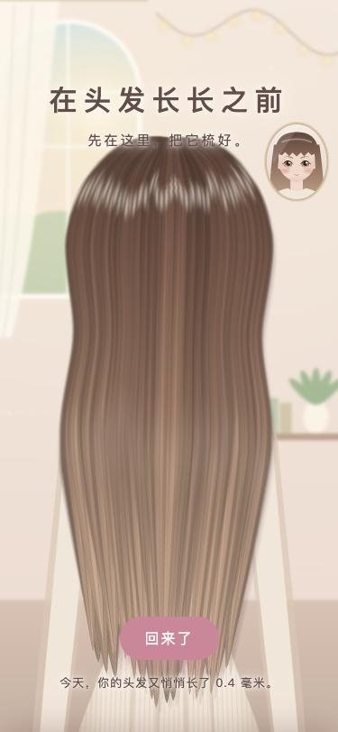

**[下载最新版 APK](https://github.com/TTStick/Before-Long/releases/latest)**

</div>

## 用手玩头发

按住头发，画面里会伸出一只手。可以抓起一把提起来，松手让它落回去。抓着打圈，头发会一圈圈绕上手指，松手就变成一绺小卷。想让它变直，用梳子梳一梳就好。

<table>
  <tr>
    <td align="center">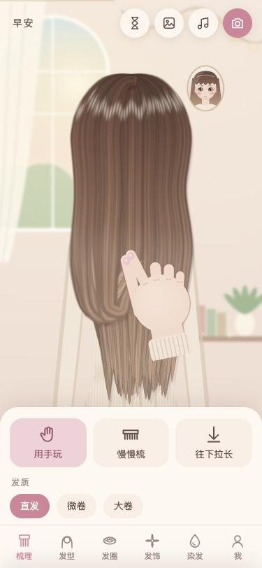<br>抓起一把</td>
    <td align="center">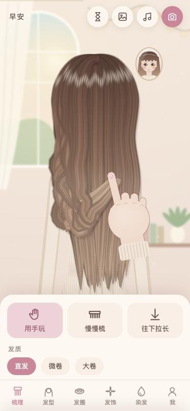<br>手指打圈</td>
    <td align="center">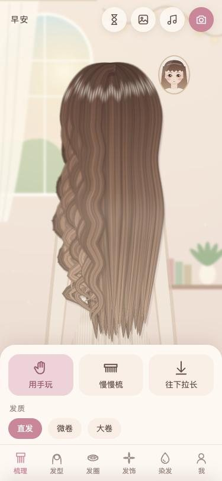<br>松手变小卷</td>
  </tr>
</table>

## 一下一下地编

编麻花辫时左右滑动，三股头发一下一下交叉，每滑一下响一个音。盘丸子、绕发圈、拧绳辫都靠手指打圈。不想自己动手的时候，点一下“帮我梳好”。

<div align="center">
  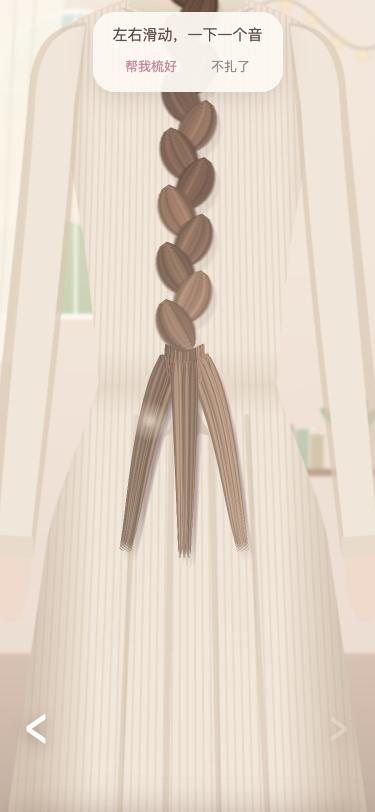
</div>

## 背影也很好看

一共 11 种发型，除了下面这些，还有披发和低马尾。

<table>
  <tr>
    <td align="center">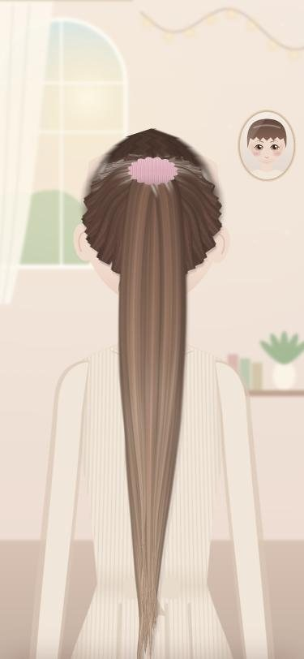<br>高马尾</td>
    <td align="center">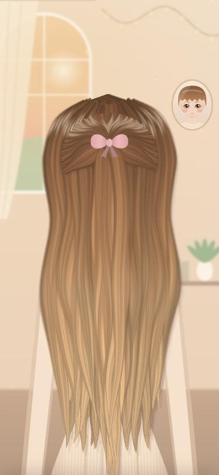<br>半扎蝴蝶结</td>
    <td align="center">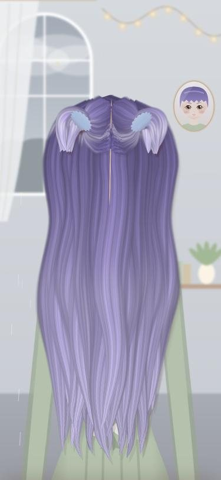<br>两个小揪揪</td>
  </tr>
  <tr>
    <td align="center">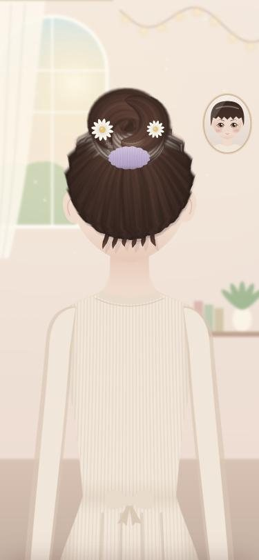<br>丸子头</td>
    <td align="center">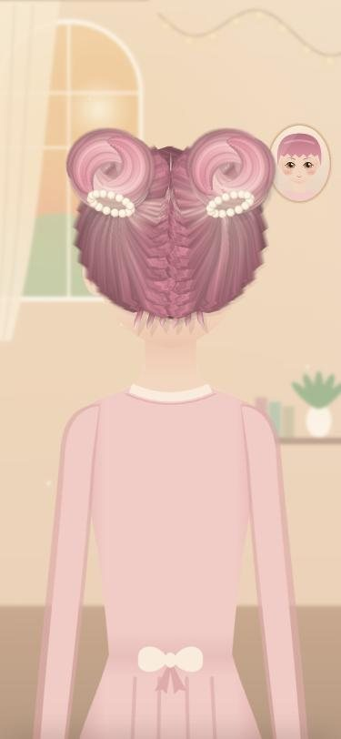<br>双丸子</td>
    <td align="center">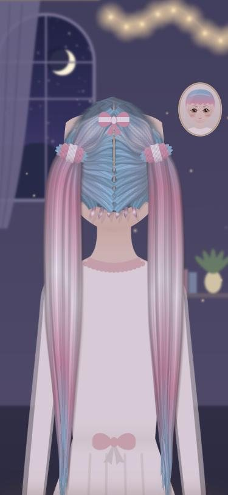<br>双马尾</td>
  </tr>
  <tr>
    <td align="center">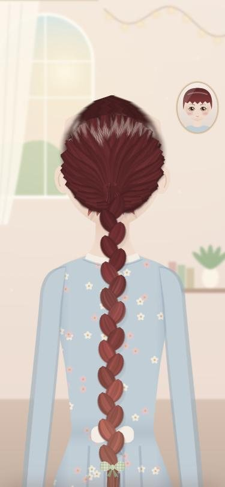<br>麻花辫</td>
    <td align="center">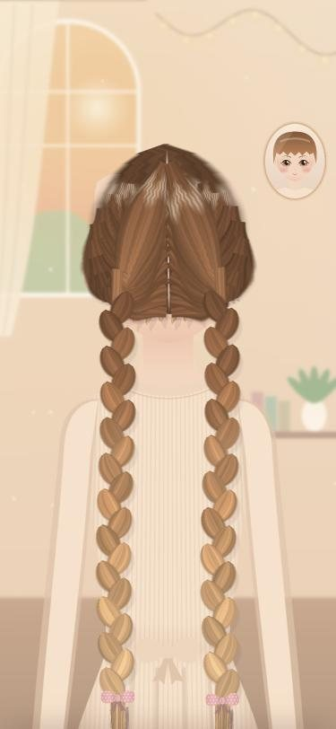<br>双麻花辫</td>
    <td align="center">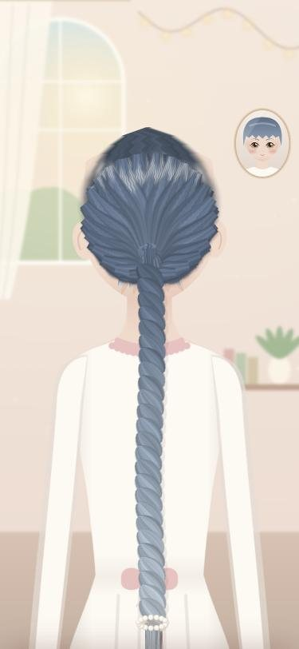<br>打圈拧绳辫</td>
  </tr>
</table>

## 等头发长长的日子

第一次打开时，告诉它现在的头发到哪里、想留到哪里，然后闭上眼睛，看头发慢慢长长。

时光沙漏可以往后拖几个月、几年，看看那时候头发大概到哪里。这里按每月约 1.2 厘米估算，每个人的速度都不太一样。

梳好以后拍一张拍立得，可以存进手机相册，也可以收进小相册，下次点开还能把那天的发型梳回来。

<table>
  <tr>
    <td align="center">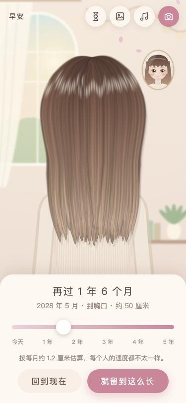<br>时光沙漏</td>
    <td align="center">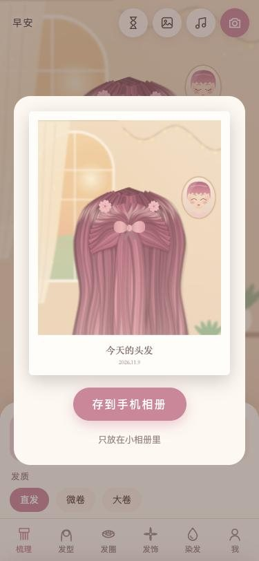<br>今天的头发</td>
  </tr>
</table>

## 抽屉里还有

- **发圈**：5 种款式、12 种颜色、6 种花样，可以自由搭配
- **发饰**：19 种小花、发夹和蝴蝶结，其中 6 种要靠完成发型慢慢收集
- **染发**：12 种配色，也能自己调发根到发梢的渐变，还能挑染
- **房间**：清晨、午后、夜晚、雨天
- **小镜子**：墙上挂着一面小镜子，她在里面眨眼，梳头时闭上眼睛，梳好了会笑
- **声音**：音乐和音效都是程序现场合成的

## 下载和安装

1. 打开 [Releases](https://github.com/TTStick/Before-Long/releases/latest)，下载最新的 APK。这个仓库是私有的，要先登录 GitHub。
2. 在安卓手机上打开 APK，按提示允许安装未知来源应用。

需要 Android 8.0 或更高版本。

## 隐私

应用没有联网权限。名字、头发长度和小相册都只留在这台手机上，没有云备份，卸载应用后存档也会一起消失。

## 从源码构建

需要 JDK 17、Python 3，以及 Android SDK 的 build-tools 35.0.0 和 platform android-35。不用 Gradle：

```bash
cd android
./build.sh
```

APK 会生成在仓库根目录。签名密钥不在仓库里，第一次构建时脚本会新生成一把，所以这样打出来的 APK 不能直接覆盖安装 Releases 里的版本。

```
game/      游戏本体：发丝物理和 WebGL 渲染、界面、合成音效
android/   安卓外壳和打包脚本
docs/      README 用的截图
```
